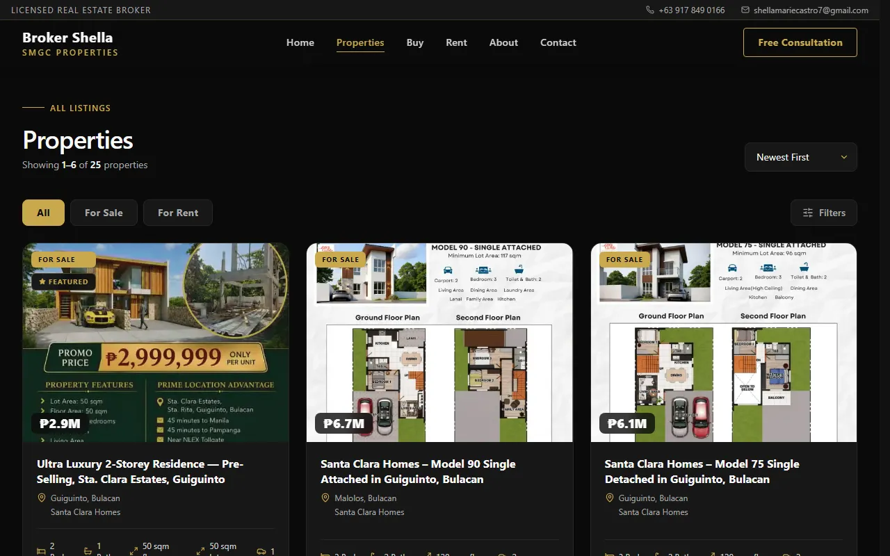
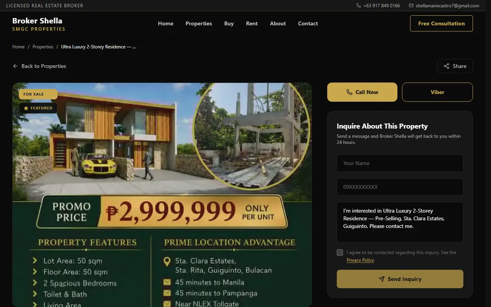

# SMGC Properties

Real estate listings and lead management for a Philippine property broker. Built with Next.js, Supabase, and Tailwind CSS.

**Live site:** [www.smgcproperties.com](https://www.smgcproperties.com/) — a production site in active use by a PRC-licensed real estate broker.

## Screenshots







## Features

- Property listings with search and filters (buy / rent)
- Property detail pages with inquiry form
- Admin portal — manage listings and leads
- Sitemap and robots.txt for SEO
- Fully responsive, mobile-first design

## Tech Stack

- [Next.js 16](https://nextjs.org/) — React framework with App Router
- [React 19](https://react.dev/) — UI library
- [TypeScript](https://www.typescriptlang.org/) — strict mode
- [Supabase](https://supabase.com/) — database and authentication
- [Tailwind CSS v4](https://tailwindcss.com/) — styling
- [next-themes](https://github.com/pacocoursey/next-themes) — theme management

## Getting Started

1. Clone the repo and install dependencies:

```bash
npm install
```

2. Create a `.env.local` file in the root:

```env
NEXT_PUBLIC_SUPABASE_URL=your_supabase_url
NEXT_PUBLIC_SUPABASE_ANON_KEY=your_supabase_anon_key
```

3. Run the development server:

```bash
npm run dev
```

Open [http://localhost:3000](http://localhost:3000) to view the site.

## Deployment

Deploy on [Vercel](https://vercel.com/) — connect your GitHub repo and add the environment variables in the project settings.

## License

All rights reserved. Source shared for portfolio purposes.
